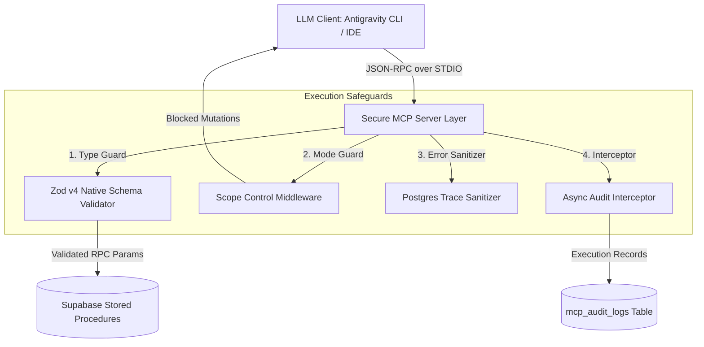

# Secure Supabase Model Context Protocol (MCP) Server

[](https://github.com/minhajadab3836/supabase-mcp-secure/actions/workflows/ci.yml)
[](https://www.typescriptlang.org/)
[](LICENSE)
[](https://nodejs.org/)

An enterprise-grade Model Context Protocol (MCP) server that grants AI agents (Antigravity IDE/CLI, Cursor, Claude Desktop) safe access to Supabase database stored procedures without exposing raw SQL execution.

---

## 1. Problem Statement

Connecting LLMs directly to SQL databases introduces critical vulnerabilities:
* **SQL Injection & Data Loss:** Unchecked LLM parameter generation can trigger unintended `DROP TABLE` or `DELETE` commands.
* **Schema Leakage:** Exposing raw internal database tables increases the attack surface.
* **Zero Visibility:** Lack of execution tracking makes auditing LLM query intents and latency impossible.

---

## 2. Architecture & Security Defenses



### Key Security Features

1. **Air-Gapped Tool Layer:** AI agents execute pre-written database functions (RPCs). Dynamic SQL construction and raw queries are strictly prohibited.
2. **Native Zod v4 Schema Validation:** Employs Zod v4's `z.toJSONSchema(schema, { io: "input" })` for native OpenAPI tool registration, enforcing strict parameter boundaries (ISO dates, UUIDs, numeric bounds).
3. **Scope Control Middleware:** Enforces `READ_ONLY` mode by default, trapping state-modifying operations unless an explicit admin token is provided.
4. **Immutable Audit Trail:** Asynchronously writes caller role, tool parameters, execution duration, and status (`SUCCESS`, `BLOCKED`, `ERROR`) to `mcp_audit_logs`.
5. **Trace Sanitization:** Strips internal PostgREST stack traces and database internal names before returning errors to the LLM client.

---
<p align="center">
  
</p>


## 3. Quickstart

### 3.1 - Prerequisites

- Node.js `>= 20.0.0`
- Supabase project with Service Role key access
- Antigravity CLI / IDE, Cursor, or Claude Desktop

### 3.2 - Installation & Build

```bash
git clone https://github.com/minhajadab3836/supabase-mcp-secure.git
cd supabase-mcp-secure
npm install
npm run build
```

### 3.3 - Database Setup (Supabase Migration)

Run the SQL migration located in `supabase/migrations/20260101000000_init_security_schema.sql` inside your Supabase SQL Editor. This initializes:
- `mcp_audit_logs` (immutable audit trail table with indexes)
- `customers` & `orders` (demo tables with sample seed records)
- `get_customer_metrics` (read-only analytical stored procedure)
- `update_customer_status` (audited mutation stored procedure)

### 3.4 - Environment Setup

Create a `.env` file in the root directory (refer to `.env.example`):
```ini
SUPABASE_URL=https://your-project.supabase.co
SUPABASE_SERVICE_ROLE_KEY=your-supabase-service-role-key
MCP_MODE=READ_ONLY
ADMIN_TOKEN=secret-admin-token-123
```

### 3.5 - Security Test Suite

Run the automated assertion script to test SQL injection rejection, scope enforcement, parameter bounding, trace sanitization, and audit logging:

```bash
npm test
```

**Expected Output:**
```plaintext
🔒 Starting Secure MCP Security Test Suite...

Test 1: SQL Injection in date parameter
✅ PASSED: SQL Injection attempt caught by Zod schema validation.

Test 2: Unauthorized mutation execution in READ_ONLY mode
[AUDIT] 2026-11-07T13:42:34.721Z | Tool: update_customer_status | Status: BLOCKED | Duration: 0ms
✅ PASSED: Scope Control guard blocked unauthorized mutation.

Test 3: Parameter overflow constraint check
✅ PASSED: Parameter bound correctly enforced by Zod max limit.

Test 4: Error trace sanitization
✅ PASSED: Sensitive database details stripped from error output.

Test 5: Scope authorization verification
✅ PASSED: Scope guard correctly validates admin credentials.

🎉 Security suite complete. All 5 defense boundaries verified.
```

---

## 4. Client Integration

### Option 1: Antigravity IDE Workspace Auto-Discovery (`.antigravity/mcp.json`)

Place or update `.antigravity/mcp.json` in your workspace root:
```json
{
  "mcpServers": {
    "supabase-secure": {
      "command": "node",
      "args": ["./dist/index.js"],
      "env": {
        "SUPABASE_URL": "https://your-project.supabase.co",
        "SUPABASE_SERVICE_ROLE_KEY": "your-service-role-key",
        "MCP_MODE": "READ_ONLY",
        "ADMIN_TOKEN": "secret-admin-token-123"
      }
    }
  }
}
```

### Option 2: Antigravity CLI Manual Registration

Register the binary directly via CLI:
```bash
antigravity mcp add supabase-secure \
  --command node \
  --args "$(pwd)/dist/index.js" \
  --env SUPABASE_URL="https://your-project.supabase.co" \
  --env SUPABASE_SERVICE_ROLE_KEY="your-service-role-key" \
  --env MCP_MODE="READ_ONLY"
```

---

## 5. Security Threat & Defense Matrix

| Threat Vector | Input Payload Attempt | Defense Mechanism | System Outcome |
| :--- | :--- | :--- | :--- |
| **SQL Injection** | `startDate: "2024-01-01'; DROP TABLE orders; --"` | Zod Date Regex Constraint | Throws `z.ZodError`; execution halts before database contact |
| **Unauthorized Write** | Mutation tool call under `MCP_MODE=READ_ONLY` | Scope Control Guard | Intercepts call, returns `SECURITY_VIOLATION`, logs `BLOCKED` status |
| **Parameter Overflow** | `limit: 99999` | Zod Range Constraint (`max(50)`) | Throws `z.ZodError`; prevents memory and query resource exhaustion |
| **Schema Leakage** | Database execution failure or missing relation | Error Sanitizer Middleware | Strips internal Postgres engine details (`PGRST200`, table names) |
| **Audit Bypass** | Any tool execution attempt | Async Audit Interceptor | Logs caller role, parameters, latency, and status to `mcp_audit_logs` |

---

## 6. Architecture & Threat Model

For the in-depth isolation specifications and architectural boundary breakdown, see [docs/architecture.md](docs/architecture.md).

---

## 7. License

MIT License. See [LICENSE](LICENSE) for details.
