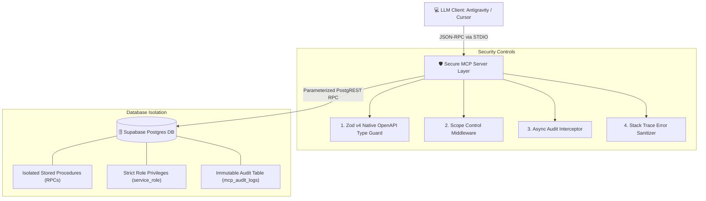

# 🏛️ Architecture & Threat Model

This document outlines the security architecture and isolation mechanisms of the Secure Supabase MCP Server.

## 1. System Boundary Diagram

## 2. Layered Threat Defenses

### A. Parameter Parsing & Injection Defense
* **Mechanism:** Zod schemas perform runtime validation before any database call is initiated.
* **Mitigation:** Standard SQL injection vectors (such as `' OR 1=1; DROP TABLE users; --`) fail Zod string regex checks and immediately throw a `z.ZodError`, halting execution prior to database contact.

### B. Privilege Escalation & State Mutation Defense
* **Mechanism:** The Scope Control middleware (`src/middleware/scopeCheck.ts`) checks the global `MCP_MODE` setting and caller arguments.
* **Mitigation:** In `READ_ONLY` mode, any tool flagged as a state mutation (e.g., updates, deletes) is trapped before reaching the database, returning a `SECURITY_VIOLATION` error and writing a `BLOCKED` event to the audit trail.

### C. Database Schema Leakage Defense
* **Mechanism:** The Error Sanitizer middleware (`src/middleware/errorHandler.ts`) intercepts raw Postgres engine errors.
* **Mitigation:** Internal table names, PostgREST error codes (e.g., `PGRST200`), and stack traces are stripped before responses return to the LLM client, preventing schema mapping.

### D. Audit Compliance & Observability
* **Mechanism:** An asynchronous interceptor (`src/middleware/auditLogger.ts`) logs every execution attempt.
* **Mitigation:** Captured metadata includes execution timestamp, tool name, caller scope, input payload, latency (ms), and status (`SUCCESS`, `BLOCKED`, `ERROR`).
